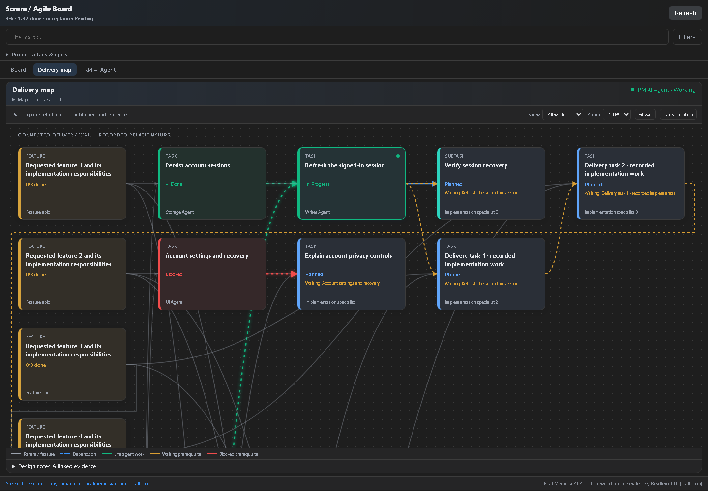
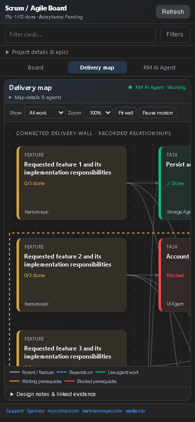
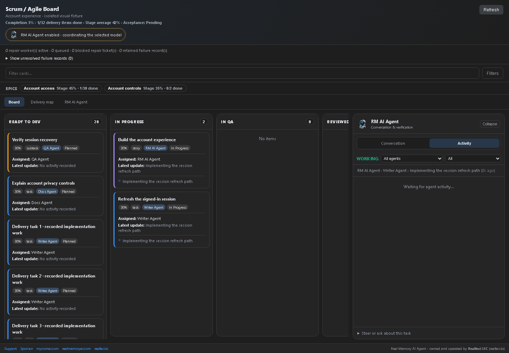
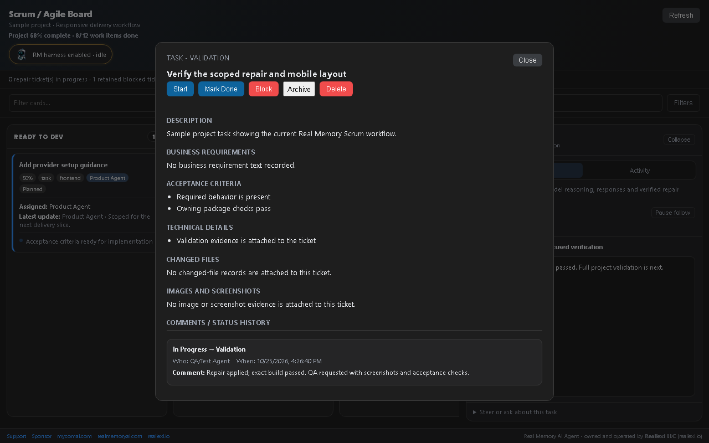
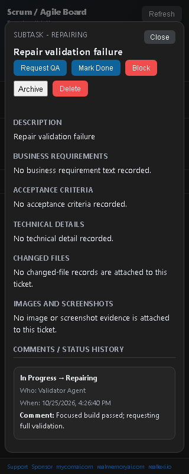
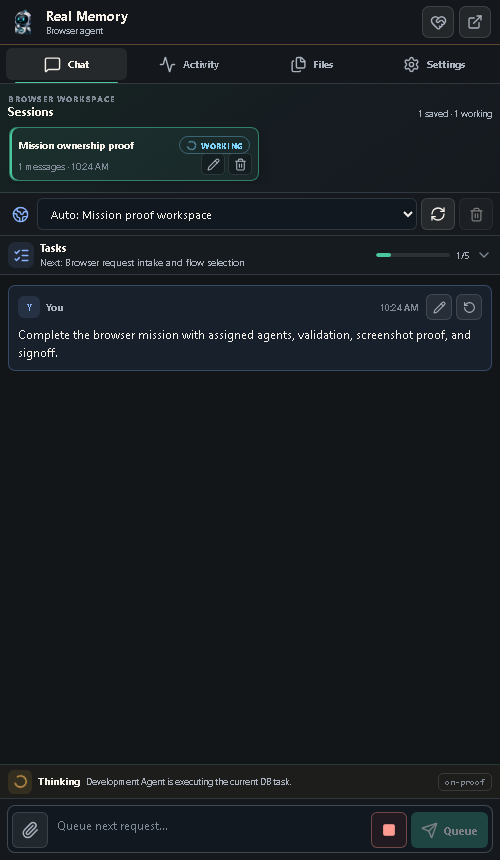

# Media Assets for Extension Listings and Screen Recording Docs

Public README, store, and hosted-policy assets live here.

- `media/sqlite-editor/` - public media, screenshots, package details, and store policy files for Reallexi SQLite Editor.
- `videos-imges-downloader/` - assets for the image, video, and screen recorder browser extension.
- `realmemory/` - assets for Real Memory Browser Agent.
- `store/` - legacy/shared store media.

## VS Code connected delivery wall

Open **RM AI Agent: Scrum / Agile Board → Delivery map** to follow recorded feature, request, task and subtask links. Ticket colors show their current stage. Red links identify blocked prerequisites, amber links show unfinished prerequisites, and green animated links identify active work. Select a ticket to inspect prerequisites, the work it blocks, design notes, files and evidence. Drag the background to pan, change zoom, or use **Fit wall**. Long request text, epics and agent lists stay collapsed until you open details. The page scrolls, and the Kanban board scrolls vertically and horizontally and preserves its position during refreshes.

A fully delivered development ticket can reach Done before the separate final Validator runs. Done on a development ticket records implementation delivery; feature acceptance and project completion still need their validation evidence. Partial writes and model replies alone do not close tickets.

These are actual Chromium renders of the VS Code webview with explicitly labelled sample project data. They demonstrate UI behavior, not a live model run or completed customer project. This map is a VS Code feature; browser and CLI interfaces retain their own views. [Screenshots, before/after evidence and verification notes](https://github.com/ddkits/Reallexi-Public-media-and-files/blob/main/realmemory/releases/1.6.338/README.md).

## Real Memory AI Agent

[Product website](https://ddkits.github.io/Ollama-VScode-Free-Agent/) · [Public usage guide/wiki](https://ddkits.github.io/Ollama-VScode-Free-Agent/wiki/) · [Privacy](https://ddkits.github.io/Ollama-VScode-Free-Agent/privacy/) · [Terms](https://ddkits.github.io/Ollama-VScode-Free-Agent/terms/) · [Security](https://ddkits.github.io/Ollama-VScode-Free-Agent/security/).

The public site contains user-facing product information only. Product implementation source remains in a private repository. Store availability and listed versions vary by platform; use each store listing for current installation details.

### Current sample screenshots and trailer

These screenshots show the current product UI with sample project data; they are not customer records or a live model session.

[Watch or download the captioned 21-second product trailer](realmemory/store/real-memory-ai-agent-trailer.mp4) · [Trailer captions](realmemory/store/real-memory-ai-agent-trailer-captions.vtt) · [Unified privacy policy](realmemory/store/real-memory-ai-agent-privacy-policy.md).

[1.6.338 delivery wall, screenshots and verification notes](realmemory/releases/1.6.338/README.md). [Product guide](realmemory/README.md).
