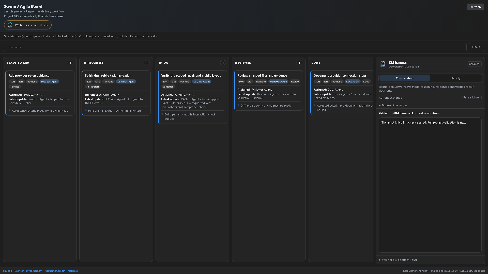
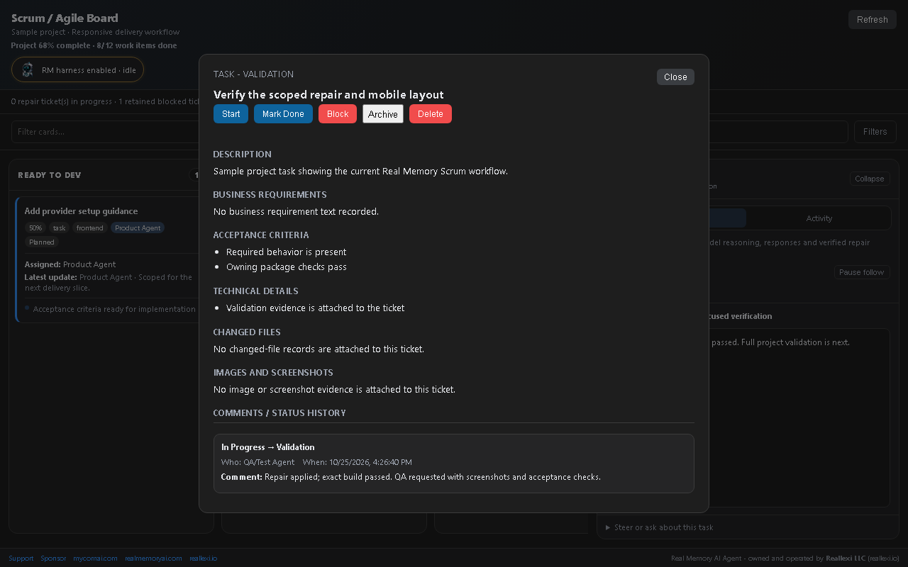
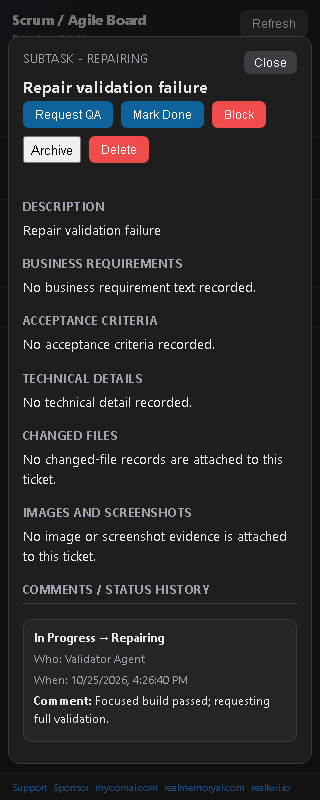
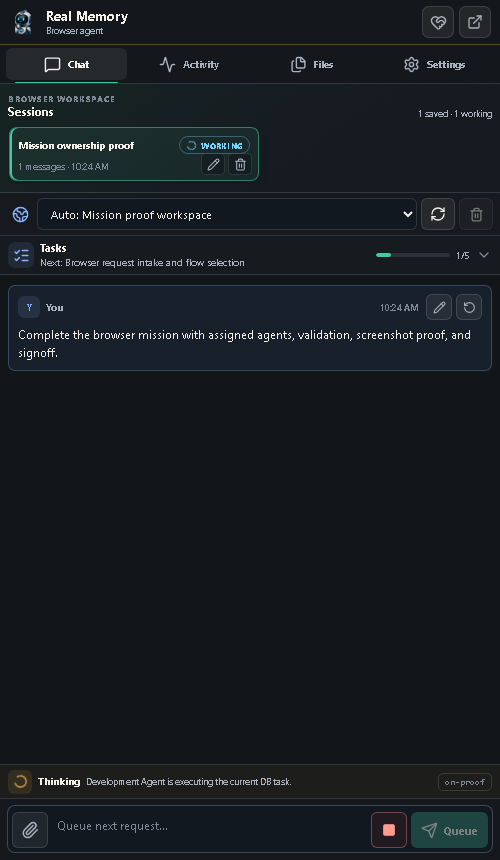

# Media Assets for Extension Listings and Screen Recording Docs

Public README, store, and hosted-policy assets live here.

- `media/sqlite-editor/` - public media, screenshots, package details, and store policy files for Reallexi SQLite Editor.
- `videos-imges-downloader/` - assets for the image, video, and screen recorder browser extension.
- `realmemory/` - assets for Real Memory Browser Agent.
- `store/` - legacy/shared store media.

## Real Memory AI Agent

[Product website](https://ddkits.github.io/Ollama-VScode-Free-Agent/) · [Public usage guide/wiki](https://ddkits.github.io/Ollama-VScode-Free-Agent/wiki/) · [Privacy](https://ddkits.github.io/Ollama-VScode-Free-Agent/privacy/) · [Terms](https://ddkits.github.io/Ollama-VScode-Free-Agent/terms/) · [Security](https://ddkits.github.io/Ollama-VScode-Free-Agent/security/).

The public site contains user-facing product information only. Product implementation source remains in a private repository. Store availability and listed versions vary by platform; use each store listing for current installation details.

### Current sample screenshots and trailer

These screenshots show the current product UI with sample project data; they are not customer records or a live model session.

[Watch or download the captioned 21-second product trailer](realmemory/store/real-memory-ai-agent-trailer.mp4) · [Trailer captions](realmemory/store/real-memory-ai-agent-trailer-captions.vtt) · [Unified privacy policy](realmemory/store/real-memory-ai-agent-privacy-policy.md).

[1.5.314 release guide, bounded preservation recovery, automatic-continuation safety, settings and screenshots](realmemory/releases/1.5.314/README.md). [Product guide](realmemory/README.md).
