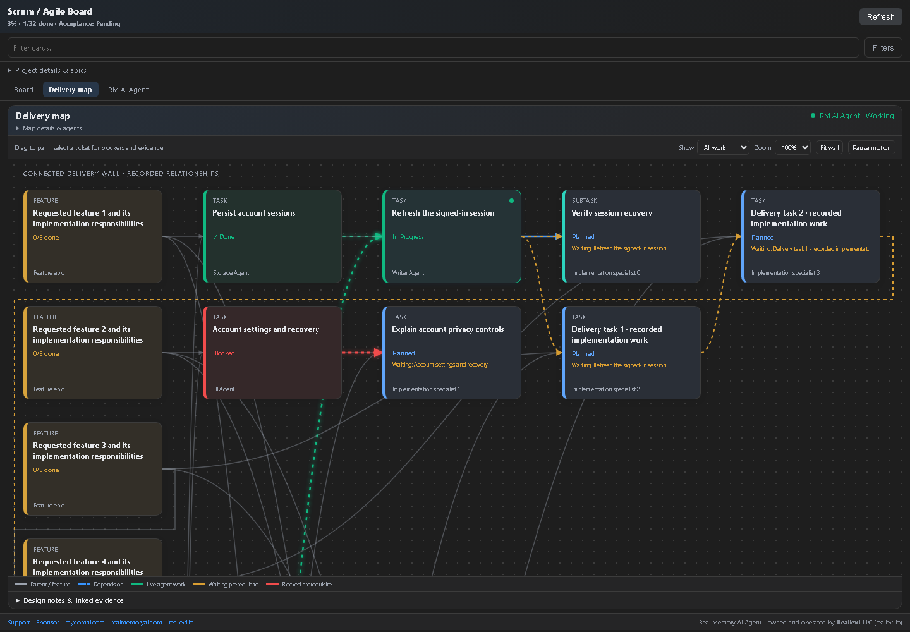
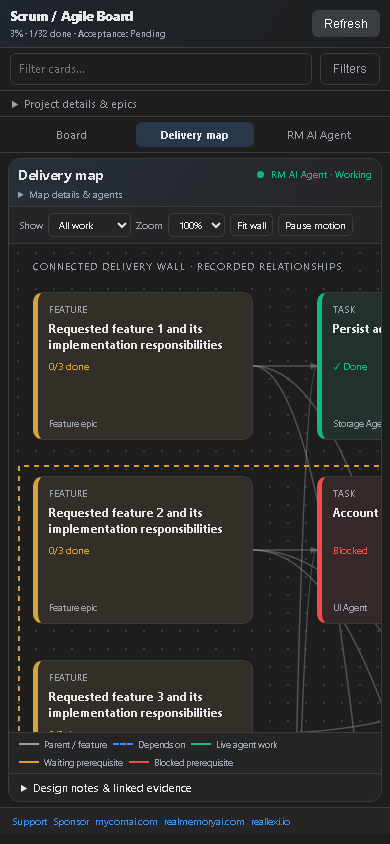
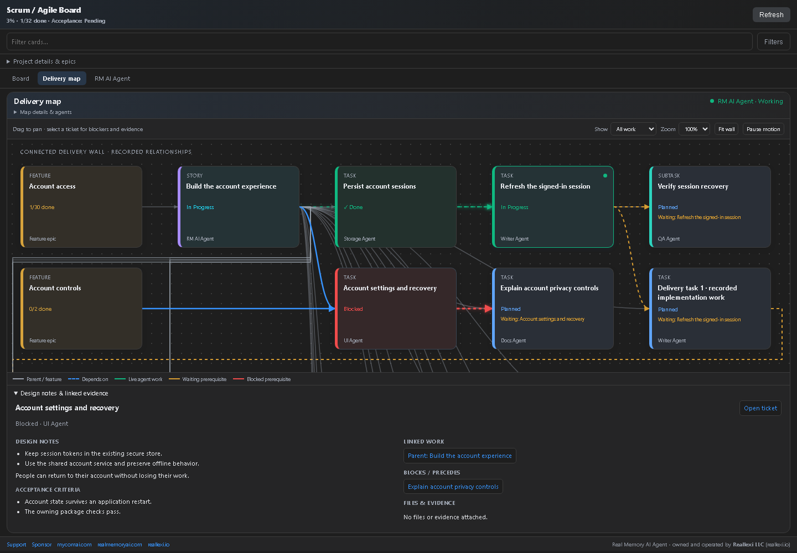

# Compact Scrum board and Delivery map — 1.6.338

Tickets now take priority over project context. Long request text, epics and repair history are collapsed under **Project details & epics**. The map keeps assigned agents, its repeated description and detailed counts under **Map details & agents**. Filters stay on one compact row; the page, ticket wall and map support scrolling. Pan, zoom and Fit wall remain available.

The same long sample prompt, eleven epics, recorded dependencies, route, theme and viewport were used before and after. At 390 × 844, the map viewport starts at about 243 px after the change, compared with 934 px before it. The board starts at about 158 px instead of 394 px. Hidden context remains available by opening details. These are real Chromium renders of production VS Code webview HTML with sample data and an isolated host adapter; they do not prove a live model run or installed-host completion.

[Before/after measurements and image hashes](visual-proof.json) · [Earlier connected-wall, blocker and runtime verification](../1.6.337/README.md).

Fully delivered development tickets can reach Done independently of final testing. Feature acceptance and project completion still require validation evidence. This map is a VS Code feature; browser and CLI surfaces keep their own interfaces.

Verification: 118 focused UI/board checks, 57 packaged checks and 47 artifact checks pass; TypeScript checks pass. Installed-host acceptance and the original model run remain separate.

