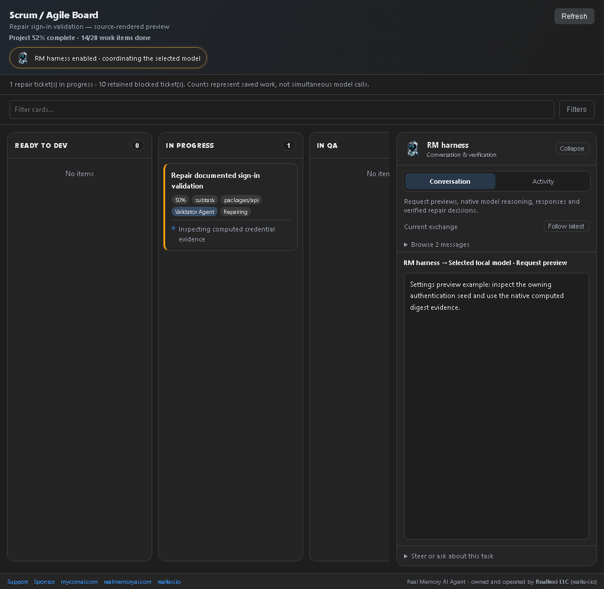
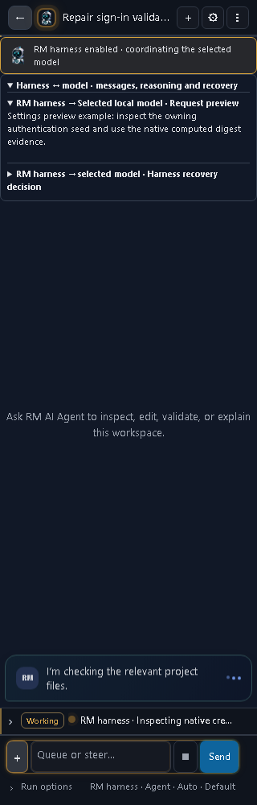

# RM AI Agent 1.5.314 — Bounded preservation recovery

Optional project guidance, verified repair memory and bounded recovery for the VS Code agent, with synchronized browser and npm CLI builds.

## What changed

- When a Writer proposes a destructive whole-file replacement, it gets one bounded correction grounded in the current source. If that correction is also destructive—even when disguised as a `replacements[]` entry covering most of the file—the harness parks the chunk immediately instead of repeating the same request through eight cooldown attempts. The blocker follows automatic same-specification continuation while the protected source SHA-256 is unchanged; a legitimate edit invalidates it and reopens repair. Provider stalls, rate limits and stale anchors keep their normal retry behavior.
- Filename-less ESLint configuration syntax failures are localized before a model repair begins. The harness runs a read-only syntax check across the active package's existing flat configs and inherited ancestor configs, identifies the one malformed file, fingerprints that exact failure, and limits repair to the proven config. One proven missing closer is repaired locally. Every local or model-produced config candidate must parse before it can replace disk bytes, preventing alternating malformed writes. Application components are never guessed from an ESM loader-only stack.
- Malformed structured Ollama responses that repeat the RM output-boundary key are cancelled before the repeated protocol text reaches the Harness reader. Partial output is never applied, one same-model recovery keeps the original task evidence, and a second failure stops at `provider_retry` instead of streaming forever.
- Adaptive harness controls are beside the VS Code model and flow selectors.
- Project guidance lets you save corrections and preferences explicitly.
- Verified repair memory is a separate opt-in. It records involved file paths and a successful-validation observation after a diagnosed repair passes its check.
- Automatic repair can be disabled. A per-fingerprint limit prevents repeated diagnosis attempts from gaining a fresh budget through Continue.
- Ollama recovery detects sustained repeated reasoning and numeric narrative cycles. It tries one output recovery; a repeated failure follows the existing provider retry/failover path. Distinct long reasoning and structured patches containing numeric fixtures remain supported.
- Authentication browser failures identify inspected hashing-source files. The repair instruction requires executable digest computation with the actual algorithm, salt, encoding and length, followed by valid and invalid sign-in checks. A plausible-looking model-generated hash is not verification.
- The Scrum board now has bounded horizontal lanes and a dedicated Harness reader with Conversation and Activity tabs. Narrow views switch between Board and Harness, and reduced-motion preferences are respected.
- A scoped validation repair reruns the exact failed check first, then the full project validation. The focused pass verifies the fix but cannot mark the project complete by itself.
- Concrete ESLint rule-loader errors use the configured rule, resolved rule, and plugin in their fingerprint, so genuinely new rule failures receive separate bounded repair opportunities while identical failures remain capped.
- A single verified ESLint 8 `no-unassigned-vars` key is repaired locally to `no-unused-vars`; ambiguous configuration is left for review instead of accepting another model-only success claim.

## Settings screenshots






These are screenshots of the actual source-rendered VS Code webview in Chromium, using the same Controller route at 1024×1000 and 320×1000. The compact view is scrolled to Model flow. They demonstrate settings layout and messages, not a live installed model mission. Before/after comparison and raw test logs stay in private release evidence.

## Install and start

### VS Code

Install the [audited 1.5.314 VSIX](https://github.com/ddkits/Reallexi-Public-media-and-files/releases/download/rmai-v1.5.314/real-memory-ai-agent-1.5.314.vsix) through **Extensions → … → Install from VSIX**. Reload VS Code after replacing an installed version.

Open a project folder, open RM AI Agent, and choose a provider and model. For local inference, connect the Ollama or llama.cpp server you already run. Use the connection test before sending a task. Choose Agent mode for implementation work, and review the active approval settings before allowing file changes or commands.

### CLI

```sh
npm install --global ./reallexi-rmai-1.5.314.tgz
rmai --version
rmai settings
rmai chat --project .
rmai run "Fix the failing tests" --dry-run
```

First download the [audited CLI tarball](https://github.com/ddkits/Reallexi-Public-media-and-files/releases/download/rmai-v1.5.314/reallexi-rmai-1.5.314.tgz). Node.js 18 or newer is required. The CLI is independent of the VS Code extension. These Adaptive harness controls are currently a VS Code feature; the CLI and Chrome/Edge clients keep their own settings.

## Enable the harness

1. Open **RM AI Agent → Settings → Controller**.
2. Select your provider, model and flow.
3. Turn **Adaptive harness** on. It defaults off.
4. Enter your preferences in **Project guidance**, for example: “Reuse the existing API; preserve unrelated files; run the owning package tests.”
5. Turn **Remember verified repairs** on only if you want successful path/outcome observations saved. It defaults off.
6. Choose **Automatic repair** and a **Harness repair limit** from 1 to 5. Automatic repair defaults on within the optional harness, and the limit defaults to 2. Existing safety limits still apply.
7. Review **Verified repair memory** whenever needed. Edit it or clear the field to forget observations.

## What learning means

This feature does not train or modify model weights. It supplies reviewable project guidance and relevant historical observations to the selected model. It does not automatically treat every chat correction, failed attempt or model explanation as a permanent instruction.

Learned observations contain file paths and successful validation outcomes. They do not copy raw diagnostics, credentials, source or reasoning into this memory. A saved observation is supplied only when its file path matches current context, and must be checked against current source. You can edit or clear both guidance and memory.

Settings saved by these controls are scoped to the current workspace. The selected provider determines where inference runs. A hosted provider receives the context supplied to that model; choosing a local provider keeps inference on that local endpoint. Do not put credentials in project guidance.

## Failure and recovery behavior

The workflow is request → inspect → implement → validate → diagnose → submit scoped repair → rerun the exact failed check → full validation. A focused pass verifies the fix but cannot close the project. A failed check is retained as evidence and does not become a successful result merely because the model says it is fixed.

The harness limit applies to the existing persisted failure fingerprint, including its recorded count. Continue does not clear that history. Disable Automatic repair to retain the failure for review before another automatic diagnosis/repair attempt. Reaching either the harness limit or an existing safety budget blocks further attempts for that failure. Inspect the retained cause, source, command output and environment before deciding what to change.

For a documented sign-in failure, inspect the current README credential, authentication seed and verifier together. Compute the digest with executable code, retain the documented credential and rejection behavior, rebuild the owning API, and verify that the running server uses the rebuilt code. The extension repair adds evidence and ownership guidance; it does not silently rewrite a user's application seed or live task database.

## Validation and release status

The full suite passed 3,144 tests, with one POSIX-only test skipped on Windows. The required `npm run package` completed for 1.5.314, 62 focused post-package checks passed, and package/credential audits plus the standalone CLI publication dry-run passed. The user-provided 1.5.312 trace is the before-state evidence: the preservation guard correctly rejects destructive `server.js` rewrites, but the pool repeats the unchanged initial/correction pair through all eight attempts and automatic continuation can restart it. The regressions prove the second destructive answer parks immediately, survives an unchanged continuation, and reopens only when source evidence changes.

The packaged VSIX, Chrome/Edge ZIPs and CLI tarball were inspected: no private source entries, source maps or matching local credential values were found. The installed VSIX runtime hash matches the source build. Checksums are in [SHA256SUMS](releases/1.5.312/SHA256SUMS).

The production dependency audit still reports two high-severity findings in the existing Node 18 compatibility LangChain/Zod chain. This release is not described as vulnerability-free or fully published. The original application's live sign-in mission was not rerun or manually marked complete; its seed and runtime database were preserved.

Publication outcomes:

- Private source, tag and release `v1.5.312` pushed: [source commit](https://github.com/ddkits/Ollama-VScode-Free-Agent/commit/d3d3767ff2155b452b28c526cd75118dfafe22ec).
- Audited packages are offered as [release downloads](https://github.com/ddkits/Reallexi-Public-media-and-files/releases/tag/rmai-v1.5.312).
- Protected GitHub build/test passed. Protected npm publication failed with registry E404/permission for the first `@reallexi/rmai-ui-*` package, and Marketplace publication failed because the configured publisher PAT is unauthorized. Exact run links and error scope are in the [1.5.312 release guide](releases/1.5.312/README.md); the downloadable VSIX, browser ZIPs and CLI tarball remain available.

Screenshots and documents are public; private source changes, regression tests, runtime databases, pasted traces and raw local proof remain outside this media repository.

## Product and support

- Product: https://realmemoryai.com
- Publisher: https://reallexi.io
- Sponsors: https://github.com/sponsors/ddkits
- Support: https://reallexi.io/support
