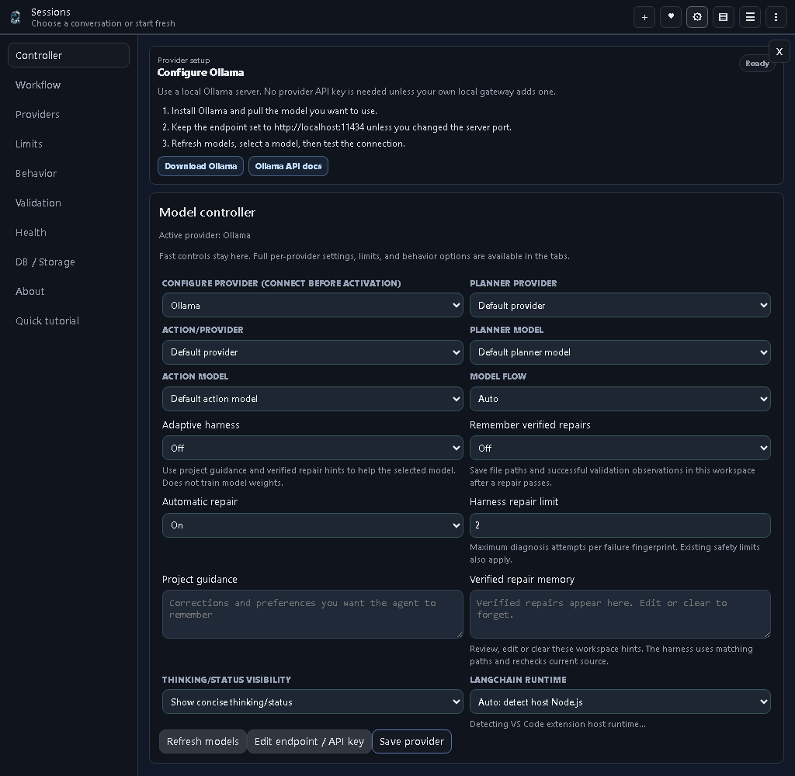
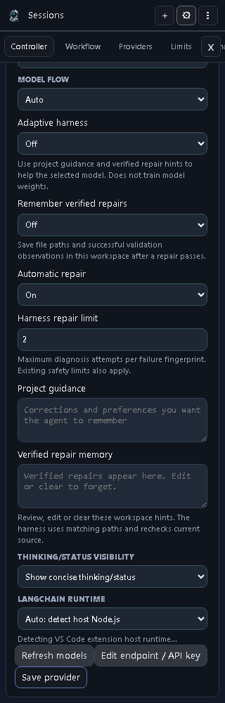

# RM AI Agent 1.5.303 — Adaptive harness

Optional project guidance, verified repair memory and bounded recovery for the VS Code agent, with synchronized browser and npm CLI builds.

## What changed

- Adaptive harness controls are beside the VS Code model and flow selectors.
- Project guidance lets you save corrections and preferences explicitly.
- Verified repair memory is a separate opt-in. It records involved file paths and a successful-validation observation after a diagnosed repair passes its check.
- Automatic repair can be disabled. A per-fingerprint limit prevents repeated diagnosis attempts from gaining a fresh budget through Continue.
- Ollama recovery detects sustained repeated reasoning and numeric narrative cycles. It tries one output recovery; a repeated failure follows the existing provider retry/failover path. Distinct long reasoning and structured patches containing numeric fixtures remain supported.
- Authentication browser failures identify inspected hashing-source files. The repair instruction requires executable digest computation with the actual algorithm, salt, encoding and length, followed by valid and invalid sign-in checks. A plausible-looking model-generated hash is not verification.

## Settings screenshots





These are screenshots of the actual source-rendered VS Code webview in Chromium, using the same Controller route at 1024×1000 and 320×1000. The compact view is scrolled to Model flow. They demonstrate settings layout and messages, not a live installed model mission. Before/after comparison and raw test logs stay in private release evidence.

## Install and start

### VS Code

Install the [audited 1.5.303 VSIX](https://github.com/ddkits/Reallexi-Public-media-and-files/releases/download/rmai-v1.5.303/real-memory-ai-agent-1.5.303.vsix) through **Extensions → … → Install from VSIX**. Reload VS Code after replacing an installed version. The Marketplace publication attempt was rejected by the publisher credential, so the Marketplace listing has not been updated to this version.

Open a project folder, open RM AI Agent, and choose a provider and model. For local inference, connect the Ollama or llama.cpp server you already run. Use the connection test before sending a task. Choose Agent mode for implementation work, and review the active approval settings before allowing file changes or commands.

### CLI

```sh
npm install --global ./reallexi-rmai-1.5.303.tgz
rmai --version
rmai settings
rmai chat --project .
rmai run "Fix the failing tests" --dry-run
```

First download the [audited CLI tarball](https://github.com/ddkits/Reallexi-Public-media-and-files/releases/download/rmai-v1.5.303/reallexi-rmai-1.5.303.tgz). Node.js 18 or newer is required. The CLI is independent of the VS Code extension. These new Adaptive harness controls are currently a VS Code feature; the CLI and Chrome/Edge clients keep their own settings. Version 1.5.303 is not available from npm: the tagged publication workflow was rejected while publishing its first platform UI dependency.

## Enable the harness

1. Open **RM AI Agent → Settings → Controller**.
2. Select your provider, model and flow.
3. Turn **Adaptive harness** on. It defaults off.
4. Enter your preferences in **Project guidance**, for example: “Reuse the existing API; preserve unrelated files; run the owning package tests.”
5. Turn **Remember verified repairs** on only if you want successful path/outcome observations saved. It defaults off.
6. Choose **Automatic repair** and a **Harness repair limit** from 1 to 5. Automatic repair defaults on within the optional harness, and the limit defaults to 2. Existing safety limits still apply.
7. Review **Verified repair memory** whenever needed. Edit it or clear the field to forget observations.

## What learning means

This feature does not train or modify model weights. It supplies reviewable project guidance and relevant historical observations to the selected model. It does not automatically treat every chat correction, failed attempt or model explanation as a permanent instruction.

Learned observations contain file paths and successful validation outcomes. They do not copy raw diagnostics, credentials, source or reasoning into this memory. A saved observation is supplied only when its file path matches current context, and must be checked against current source. You can edit or clear both guidance and memory.

Settings saved by these controls are scoped to the current workspace. The selected provider determines where inference runs. A hosted provider receives the context supplied to that model; choosing a local provider keeps inference on that local endpoint. Do not put credentials in project guidance.

## Failure and recovery behavior

The workflow is request → inspect → implement → validate → diagnose → bounded repair → validate again. A failed check is retained as evidence. It does not become a successful result merely because the model says it is fixed.

The harness limit applies to the existing persisted failure fingerprint, including its recorded count. Continue does not clear that history. Disable Automatic repair to retain the failure for review before another automatic diagnosis/repair attempt. Reaching either the harness limit or an existing safety budget blocks further attempts for that failure. Inspect the retained cause, source, command output and environment before deciding what to change.

For a documented sign-in failure, inspect the current README credential, authentication seed and verifier together. Compute the digest with executable code, retain the documented credential and rejection behavior, rebuild the owning API, and verify that the running server uses the rebuilt code. The extension repair adds evidence and ownership guidance; it does not silently rewrite a user's application seed or live task database.

## Validation and release status

All 3,114 extension tests passed locally, including compile/typecheck/bundles. The required `npm run package` completed for 1.5.303; 58 post-package checks and the CLI publish dry-run passed. The installed extension and validator hashes match the packaged build.

The packaged VSIX, Chrome/Edge ZIPs and CLI tarball were inspected: no private source entries, source maps or matching local credential values were found. The CLI tarball has exactly four files: executable, package manifest, README and license. Checksums are in [SHA256SUMS](releases/1.5.303/SHA256SUMS). The downloadable CLI uses the previously released optional terminal UI dependency; the tagged workflow builds fresh platform packages before publishing the CLI.

The production dependency audit still reports two high-severity findings in the existing Node 18 compatibility LangChain/Zod chain. This release is not described as vulnerability-free or fully published. The original application's live sign-in mission was not rerun or manually marked complete; its seed and runtime database were preserved.

Publication outcomes:

- Private source and tag `v1.5.303` pushed: [source commit](https://github.com/ddkits/Ollama-VScode-Free-Agent/commit/448b6283f1bd25595b4afb8b37351620761042f7).
- npm workflow failed with registry `E404` on PUT for `@reallexi/rmai-ui-linux-amd64@1.5.303`. The configured `ODIC_TOKEN` needs valid publication access; the CLI publish step was not reached. [Workflow result](https://github.com/ddkits/Ollama-VScode-Free-Agent/actions/runs/40200127044).
- Marketplace publication failed with `TF400813`: the publisher credential is not authorized.
- Audited local packages are offered as [prerelease downloads](https://github.com/ddkits/Reallexi-Public-media-and-files/releases/tag/rmai-v1.5.303), while registry, Marketplace and dependency findings remain unresolved.

Screenshots and documents are public; private source changes, regression tests, runtime databases, pasted traces and raw local proof remain outside this media repository.

## Product and support

- Product: https://realmemoryai.com
- Publisher: https://reallexi.io
- Sponsors: https://github.com/sponsors/ddkits
- Support: https://reallexi.io/support
