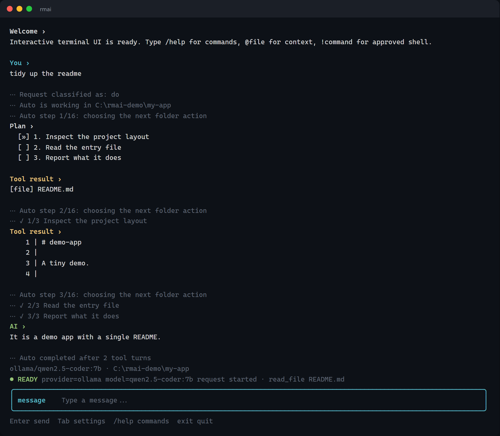
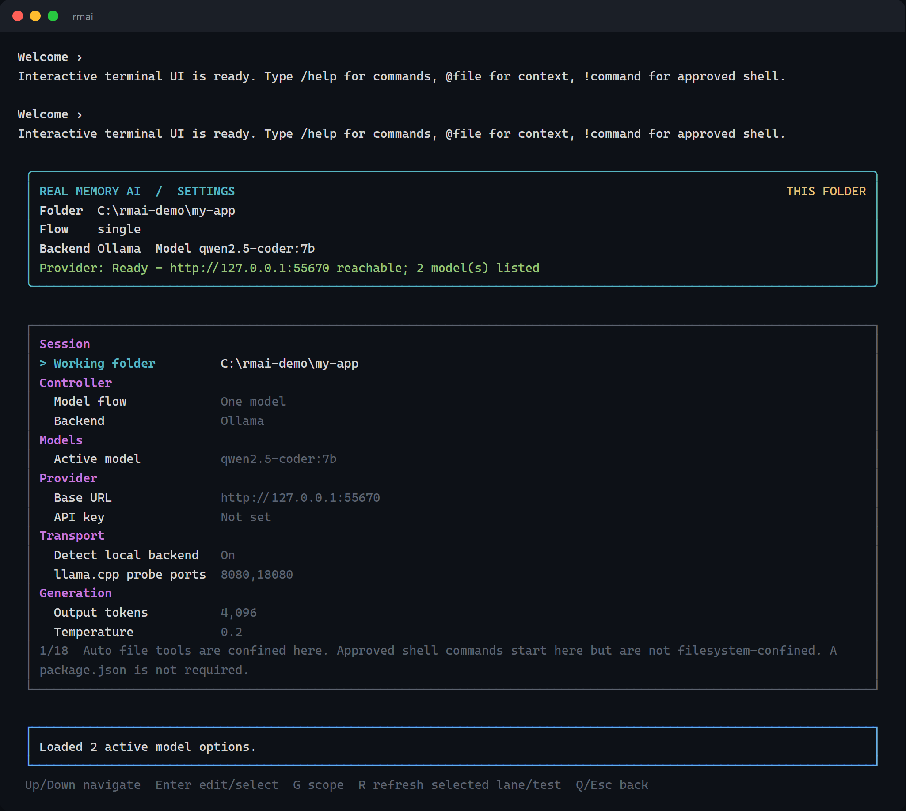

# rmai CLI

The standalone Real Memory AI Agent command-line client runs independently of the VS Code, Chrome, and Edge extensions. Run `rmai --version` to check the installed version. Find version 1.6.606 in the [public release notes and downloads](https://github.com/ddkits/Reallexi-Public-media-and-files/releases/tag/rmai-v1.6.606).



Interactive output streams to your terminal. Use its normal selection, search, and scrollback controls to review the conversation. Dim `⋯` lines record request classification, Auto steps, the responding model, and elapsed time. The selected provider may be local Ollama, NVIDIA, OpenAI, OpenRouter, or another OpenAI-compatible endpoint.

## CLI behavior and safety

Auto actions use structured JSON. If a model returns malformed or invalid action JSON, the CLI returns a bounded parser/schema diagnostic to the selected model and allows up to two correction attempts for that action. Invalid responses are never executed or treated as completed work; if correction still fails, Auto stops with a nonzero result and the validation reason.

File writes require approval unless a one-shot command uses `--yes`, which preapproves folder-confined file writes only. Shell execution is a separate capability and requires the explicit `--yes --allow-shell` combination. `--dry-run` plans without applying changes, and `--sandbox` keeps mutation approvals enabled.

The standalone CLI has its own terminal commands and settings. The VS Code Delivery map and other extension-only screens are not part of the CLI; use the VS Code extension for those views.


## Install globally

```sh
npm install --global @reallexi/rmai
rmai --version
rmai --help
```

You can also install a downloaded package artifact directly:

```sh
npm install --global ./reallexi-rmai-x.y.z.tgz
rmai --version
```

Node.js 18 or newer is required. The package is a self-contained JavaScript CLI with no required runtime npm dependencies.

### npm 12 security defaults

npm 12 does not run dependency lifecycle scripts by default and restricts Git or remote-URL dependencies unless explicitly allowed. The CLI bundle has no required runtime npm dependencies, so its normal registry install should not need those permissions. Optional platform packages may have their own requirements; review the specific npm warning before allowing anything. Avoid disabling these protections globally or using `--force` as a generic repair.

If npm reports `MODULE_NOT_FOUND` from npm's own installation tree, npm may be incomplete before it reaches the `rmai` package. If installation reports `EEXIST` for the `rmai` command, an existing file already occupies that executable path. Check `rmai --version` and the package-manager state; do not overwrite or delete an unknown shim blindly.

## Start

```sh
rmai
rmai settings
rmai chat --project .
rmai ask "Explain this project"
rmai ask "What does the auth middleware do?"
rmai run "Fix the failing tests" --dry-run
rmai run "Fix the failing tests" --yes
rmai run "Run the test suite" --yes --allow-shell
```

The CLI always shows and uses the exact folder where it was launched (or the exact `--project` folder). A Git repository or `package.json` is not required.



Open `rmai settings` or press `Tab` in chat for the full settings page: backend, model flow, discovered model, token limits, endpoint, and workflow controls. Arrow keys navigate; Enter selects or edits; `G` switches between global and current-folder scope.

Multi-step work prints a checklist and ticks steps off as they finish:

```text
Plan ›
  [x] 1. Inspect the failing test
  [»] 2. Read the module under test
  [ ] 3. Apply the fix
  [ ] 4. Run the test suite
```

The steps are the model's own declared plan, and a step is only marked done when the model advances past it — nothing is inferred from which tools happened to run. A request that genuinely takes one step shows no checklist rather than an invented one. The step in progress also stays on the status line while it runs.

In Auto flow, natural coding requests use a bounded folder-agent loop: list/read/search/file-write tools are confined to that exact folder, while file writes and shell commands pause for explicit approval. For a one-shot command, `--yes` preapproves folder-confined writes only. Shell commands start in the selected folder but are not a filesystem sandbox, so one-shot shell execution requires the separate, explicit `--yes --allow-shell` combination; `--sandbox` keeps every mutation gate enabled. Greetings and plain `exit`/`quit` never run workspace classification.

## Configuration precedence

Settings can also be automated through `rmai config --show`, `rmai set-setting`, or environment variables. Values are resolved lowest to highest:

| Source | Notes |
|---|---|
| Built-in and `package.json` defaults | |
| VS Code `realMemoryAgent.*` settings | Read only if present; the CLI never requires the extension. |
| Shared vendor variables | `NVIDIA_API_KEY`, `OPENAI_API_KEY`, `OPENROUTER_API_KEY`, `OLLAMA_HOST`, `OLLAMA_BASE_URL`, … |
| `rmai settings` / `rmai set-setting` | Saved per folder, or globally with `-g`. |
| `RMAI_*` / `REAL_MEMORY_AGENT_*` variables | For example `RMAI_NVIDIA_API_KEY`, `RMAI_BACKEND`, `RMAI_MODEL`. |
| Command-line flags | `--provider`, `--model`, `--project`, `--set key=value`. |

A vendor variable such as `NVIDIA_API_KEY` is ambient — anything on the machine may have exported it — so it acts as a convenient default but a key you deliberately save through `rmai settings` takes priority. An `RMAI_`/`REAL_MEMORY_AGENT_`-prefixed variable names this tool explicitly, so it still overrides a saved value, which is what makes CI and scripted runs work without rewriting your settings file.

Paste API keys with no surrounding quotes. Values copied from a `.env` line or a shell `export` often carry `"` characters, which would otherwise be sent as part of the credential; the CLI strips a matched wrapping pair on save and on read.

Run `rmai info` for the complete command list and interactive slash commands.
