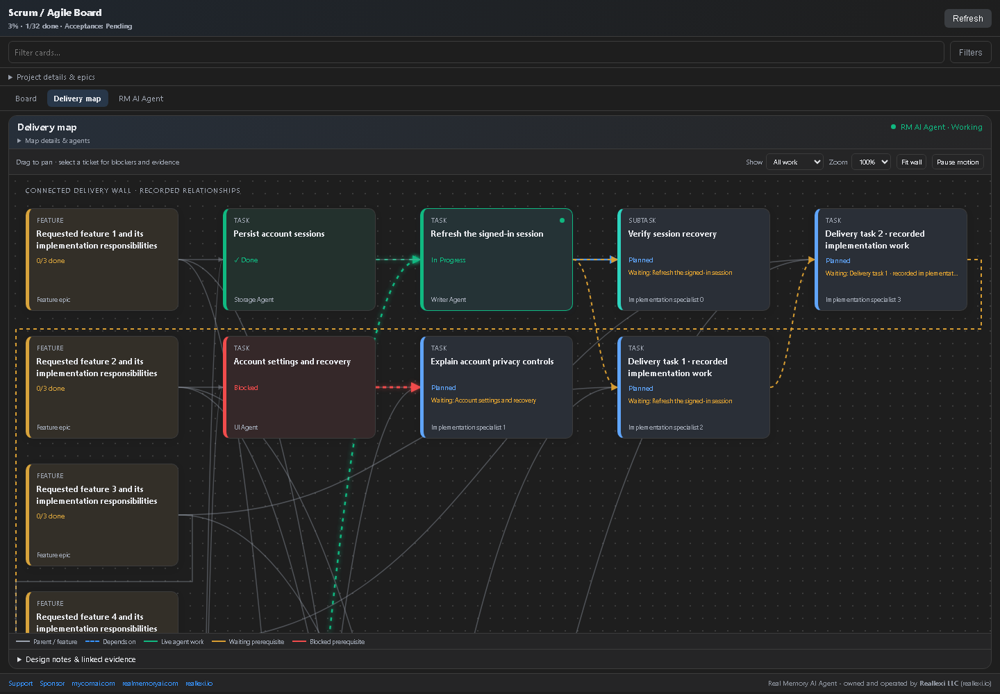
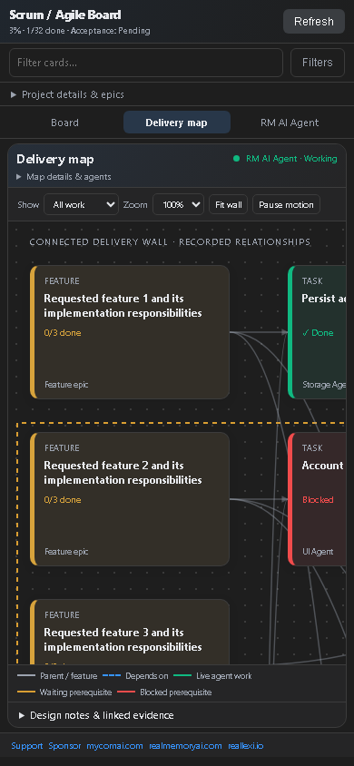

# Real Memory AI Agent

## VS Code connected delivery wall

Open **RM AI Agent: Scrum / Agile Board → Delivery map** to follow recorded feature, request, task and subtask links. Ticket colors show their current stage. Red links identify blocked prerequisites, amber links show unfinished prerequisites, and green animated links identify active work. Select a ticket to inspect prerequisites, the work it blocks, design notes, files and evidence. Drag the background to pan, change zoom, or use **Fit wall**. Long request text, epics and agent lists stay collapsed until you open details. The page scrolls, and the Kanban board scrolls vertically and horizontally and preserves its position during refreshes.

A fully delivered development ticket can reach Done before the separate final Validator runs. Done on a development ticket records implementation delivery; feature acceptance and project completion still need their validation evidence. Partial writes and model replies alone do not close tickets.

These are actual Chromium renders of the VS Code webview with explicitly labelled sample project data. They demonstrate UI behavior, not a live model run or completed customer project. This map is a VS Code feature; browser and CLI interfaces retain their own views. [Screenshots, before/after evidence and verification notes](https://github.com/ddkits/Reallexi-Public-media-and-files/blob/main/realmemory/releases/1.6.338/README.md).

