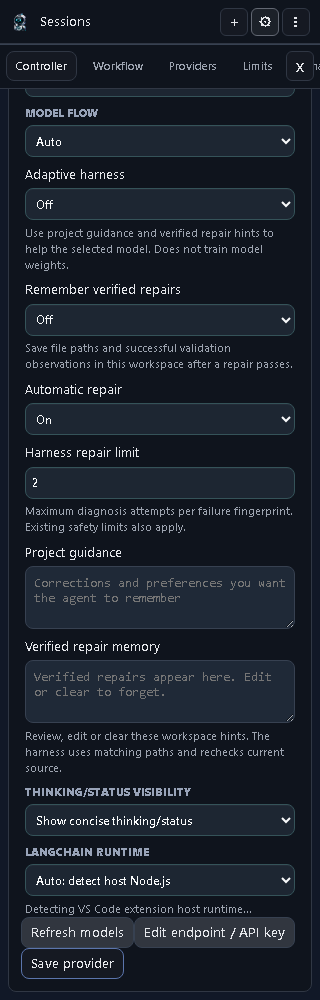
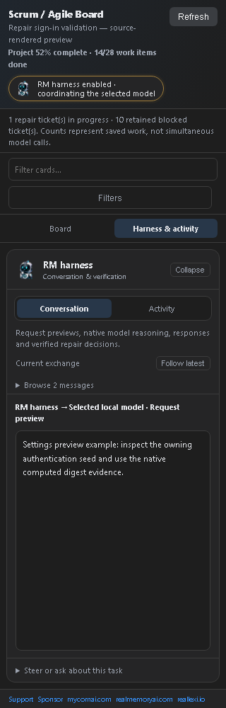
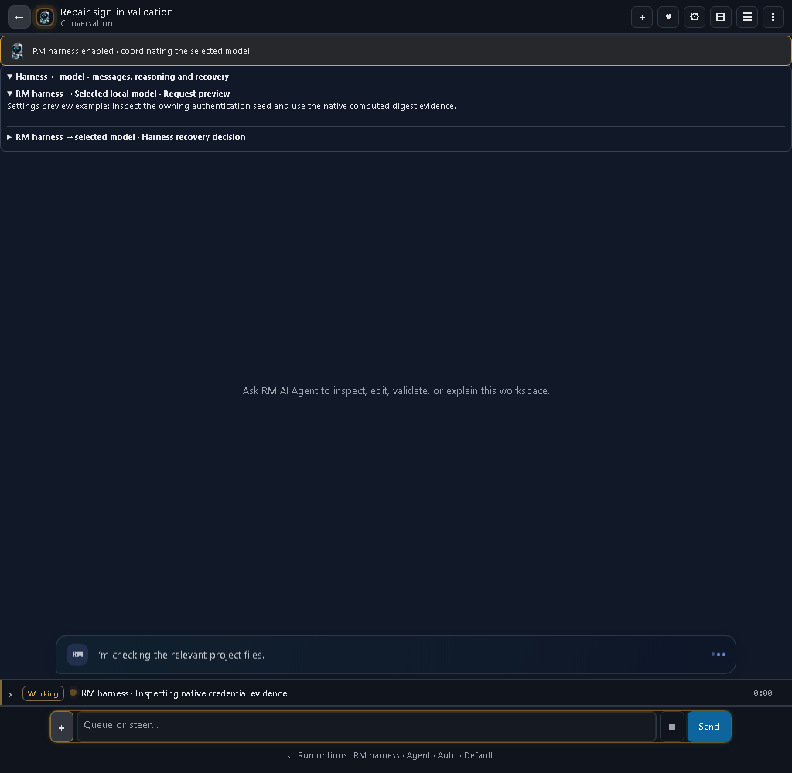

# RM AI Agent 1.5.308 — Adaptive harness and verified repair flow

Version 1.5.308 makes the optional VS Code Adaptive harness visible, readable, and responsible for coordinating validation repair around the selected model. It also repairs the installed-extension loading failure seen in 1.5.304 and ships synchronized VS Code, Chrome, Edge, MCP, and standalone CLI packages.

## What changed

- The RM robot-head badge identifies whether the harness is enabled, idle, or coordinating the selected model in both Chat and the Scrum board.
- The Scrum board uses bounded horizontal Kanban lanes and a dedicated Harness workspace. Conversation and Activity tabs keep model requests, native reasoning/output when available, repair decisions, and validation results readable.
- At narrow widths, Board and Harness are separate selectable views instead of competing stacked panes. Live polling preserves lane scroll, the selected message, and reader scroll.
- A validation path is converted to workspace-relative form only after the host proves it belongs to the active workspace. Foreign drives, outside absolute roots, traversal, dependencies, generated output, and vendor paths stay blocked.
- When a scoped repair is saved, the harness reruns the exact failed check from the trusted validation bundle. A focused pass confirms the fix but does not complete the project; the full validation bundle must pass next.
- Different ESLint rule-loader failures now have different persisted fingerprints. A repair that exposes a new incompatible rule can receive its own bounded diagnosis instead of exhausting the previous rule's budget; identical failures and the total validation loop remain capped.
- Validation failure, diagnosis, repair submission, focused verification, and final validation status appear as bounded transient Harness messages.
- Native model reasoning and output remain transient. They are not added to chat history, the runtime DB, or host logs. Known credential fields are redacted.
- Supported native three-argument scrypt evidence is computed from the documented credential and inspected source parameters. Unsupported or ambiguous algorithms remain explicit inspection work; model-invented hashes are not accepted as proof.
- Repeated speculative hash narratives and low-diversity numeric loops get one bounded output recovery before the existing provider retry/failover path.

## Screenshots

### Adaptive harness settings




### Scrum and Harness workspace




### Chat exchange view




The screenshots are source-rendered previews from the real production HTML functions, using identical fixtures at 1024×1000 and 320×1000. Example exchanges are explicitly labelled and are not presented as a live model conversation. The after-state has zero page errors and no horizontal page overflow. A separate private native-host proof confirms the installed 1.5.308 extension opens Chat and Scrum in VS Code 1.142, loads both robot icons, and resolves the packaged stylesheet.

## Install and start

### VS Code

Download the [audited 1.5.308 VSIX](https://github.com/ddkits/Reallexi-Public-media-and-files/releases/download/rmai-v1.5.308/real-memory-ai-agent-1.5.308.vsix), then use **Extensions → … → Install from VSIX** and reload the affected VS Code window.

Open **RM AI Agent → Settings → Controller** to choose the provider/model and enable Adaptive harness for the current workspace.

### Standalone CLI

```sh
npm install --global ./reallexi-rmai-1.5.308.tgz
rmai --version
rmai settings
rmai chat --project .
rmai run "Fix the failing tests" --dry-run
```

Download the [audited CLI tarball](https://github.com/ddkits/Reallexi-Public-media-and-files/releases/download/rmai-v1.5.308/reallexi-rmai-1.5.308.tgz). Node.js 18 or newer is required. The Adaptive harness controls described here currently belong to the VS Code extension; they do not train model weights or add new CLI settings.

## Enable the harness

1. Open **RM AI Agent → Settings → Controller**.
2. Choose the provider, model, and flow normally.
3. Turn **Adaptive harness** on. It defaults off.
4. Add explicit **Project guidance**, such as “reuse the existing API and run the owning package tests.”
5. Optionally enable **Remember verified repairs**. It defaults off.
6. Keep **Automatic repair** enabled for bounded self-repair, or disable it to retain failures for manual review.
7. Choose a **Harness repair limit** from 1–5; the default is 2 and existing safety limits still apply.
8. Review, edit, or clear **Verified repair memory** at any time.

## What learning means

The harness does not train or alter the selected model. It supplies reviewable workspace guidance and relevant verified observations as context.

Verified memory records involved workspace-relative file paths and successful validation outcomes. It does not copy raw diagnostics, credentials, source code, or model reasoning. A stored observation is only a hint: current source inspection and validation remain authoritative. Workspace settings and memory stay scoped to that workspace. The chosen provider still determines where inference runs.

## Validation and repair behavior

The flow is:

**request → inspect → implement → validate → diagnose → submit scoped repair → rerun the failed check → full validation**

The focused rerun is selected only from the already-approved validation command bundle; command text printed by a failing tool cannot inject a new command. If that focused check passes, the Harness says the repair is verified but keeps completion false until the original full bundle passes. If it fails, the same fingerprint, evidence, budget, and full-validation ownership are retained.

Repeated Continue actions do not erase the fingerprint count. Reaching the configured or existing repair budget blocks another identical model attempt instead of claiming success. Turning Automatic repair off remains authoritative.

## Validation and release evidence

- Pre-package full suite: **3,136 passing**, one POSIX-only test skipped on Windows.
- Required `npm run package`: passed for **1.5.308**.
- Final post-package full suite: **3,136 passing**, the same single platform skip.
- Focused packaged checks: **9 passing**, covering the recorded ESLint fingerprint progression, native ESM import, shipped CSS, path ownership, and focused/full validation ordering.
- Standalone CLI publication dry-run: passed for `@reallexi/rmai@1.5.308`.
- Installed VSIX: activated in real VS Code 1.142 with an isolated profile; Chat and Scrum commands registered and opened.
- Artifact scan: no private source paths, source maps, or matching local credential values in the VSIX, CLI tarball, or browser ZIPs. The CLI tarball contains exactly four files.

Checksums are in [SHA256SUMS](SHA256SUMS).

The production dependency audit still reports two high findings in the existing Node 18 LangChain/Zod compatibility chain. This release is not described as vulnerability-free. A later installed 1.5.307 trace exposed the ESLint fingerprint collision repaired in 1.5.308; that external application mission remained validation-blocked and is not presented as completed here.

Private source, regression tests, pasted traces, runtime databases, native screenshots containing local paths, and raw proof logs are not included in this public media repository.

## Publication status

- Private source commit: [`155b41f7`](https://github.com/ddkits/Ollama-VScode-Free-Agent/commit/155b41f70bf2bef344b5947b2f09b786c8d80962), tagged `v1.5.308`.
- Audited packages are attached to the [public prerelease](https://github.com/ddkits/Reallexi-Public-media-and-files/releases/tag/rmai-v1.5.308).
- npm and VS Code Marketplace outcomes are recorded here after their credentialed publication attempts; a local dry-run is not described as a registry publication.

## Product and support

- Product: https://realmemoryai.com
- Publisher: https://reallexi.io
- Sponsors: https://github.com/sponsors/ddkits
- Support: https://reallexi.io/support
