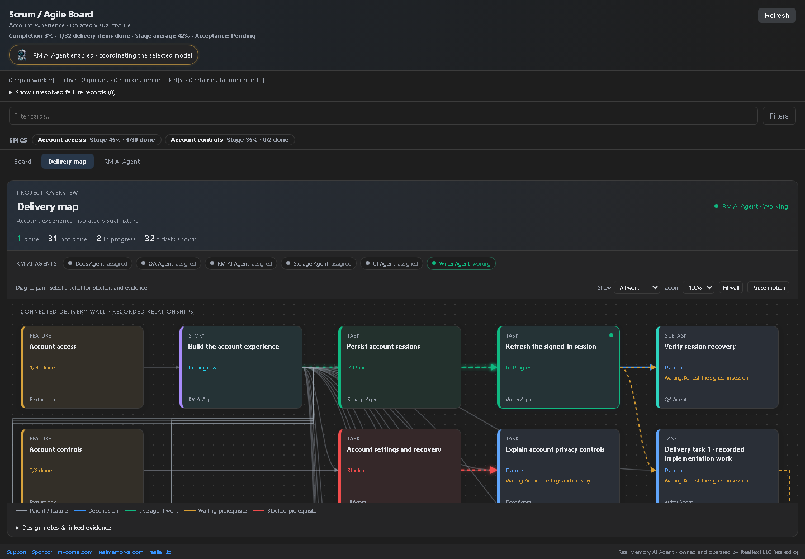
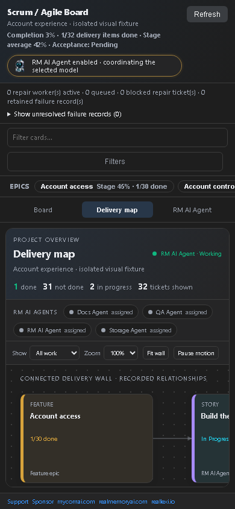
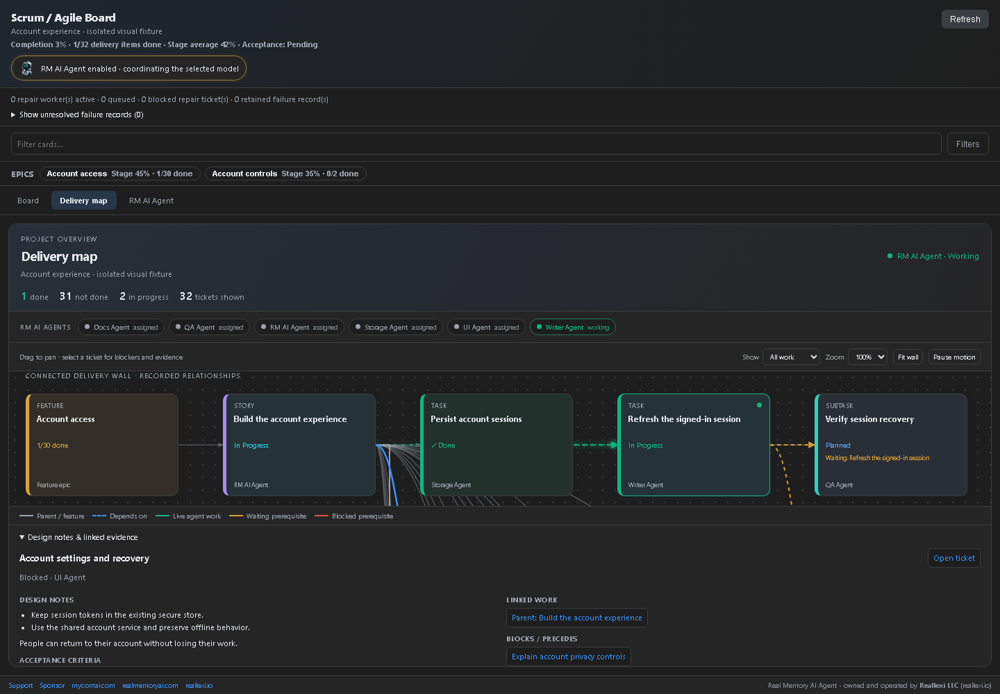
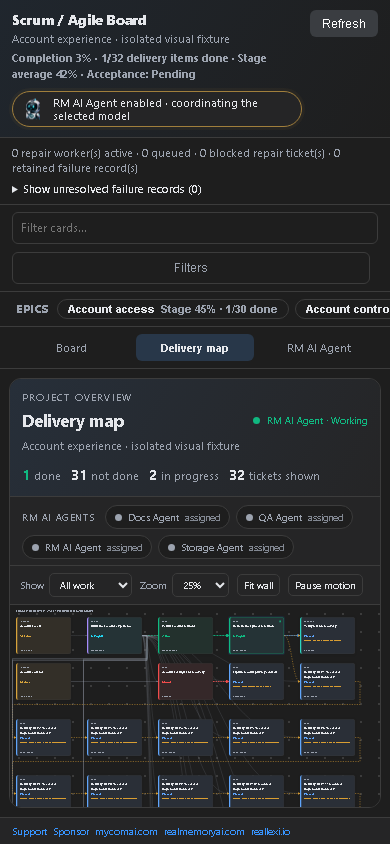

# Connected Scrum delivery wall — 1.6.337

## VS Code connected delivery wall

Open **RM AI Agent: Scrum / Agile Board → Delivery map** to follow recorded feature, request, task and subtask links. Ticket colors show their current stage. Red links identify blocked prerequisites, amber links show unfinished prerequisites, and green animated links identify active work. Select a ticket to inspect prerequisites, the work it blocks, design notes, files and evidence. Drag the background to pan, change zoom, or use **Fit wall**. The Kanban board scrolls vertically and horizontally and preserves its position during refreshes.

A fully delivered development ticket can reach Done before the separate final Validator runs. Done on a development ticket records implementation delivery; feature acceptance and project completion still need their validation evidence. Partial writes and model replies alone do not close tickets.

These are actual Chromium renders of the VS Code webview with explicitly labelled sample project data. They demonstrate UI behavior, not a live model run or completed customer project. This map is a VS Code feature; browser and CLI interfaces retain their own views. [Screenshots, before/after evidence and verification notes](https://github.com/ddkits/Reallexi-Public-media-and-files/blob/main/realmemory/releases/1.6.337/README.md).

### Before and after

The same sample project, route, theme and viewport were used for each pair: desktop 1440 × 1000 and mobile 390 × 844. Before, vertical scrolling was disabled and task dependencies shared one column. After, the board has a shared vertical scroll surface and dependency-aware colored wall. The desktop map uses the full workspace width. Red prerequisite links and ticket notes identify what blocks what; Fit wall and pan support longer plans.

[Image hashes and measured scroll evidence](visual-proof.json). These captures contain sample data only. Private prompts, provider replies, source files, runtime databases and user logs are excluded.

### Verification boundary

UI and scheduler regression checks are recorded separately from the original project. This release does not claim the paused original model run succeeded. Development completion and final project validation remain separate.

### Blockers and compact overview

Verification: 292 focused checks pass, 38 packaged checks pass, 44 artifact checks pass, and TypeScript checks pass. Browser fixtures verify source-rendered UI, not installed VS Code or the paused original model run.
